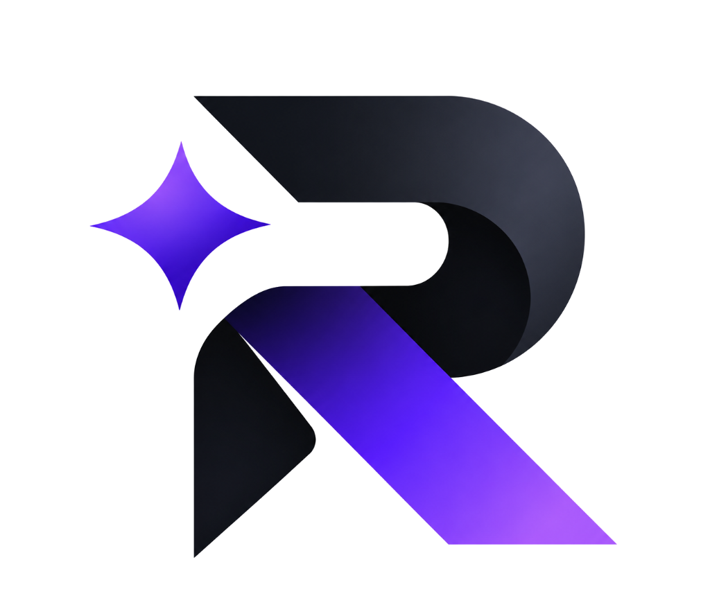

# RESH AI — Autonomous AI Systems & Enterprise Automation Infrastructure

<div align="center">
  
  <h3>Build Smarter. Automate Everything. Scale with AI.</h3>
  <p>Production-grade autonomous voice agents, intelligent lead triage, and full-stack workflow automation for modern enterprises.</p>

  <p>
    <a href="https://github.com/Kaushaltiwari27/reshai/stargazers"></a>
    <a href="https://github.com/Kaushaltiwari27/reshai/network/members"></a>
    <a href="https://github.com/Kaushaltiwari27/reshai/blob/main/LICENSE"></a>
    
    
    
    
  </p>
</div>

---

## 📑 Table of Contents

- [Executive Overview](#-executive-overview)
- [Key Features & Capabilities](#-key-features--capabilities)
- [Motion & Creative Engineering](#-motion--creative-engineering)
- [Multi-Page Architecture & Routes](#-multi-page-architecture--routes)
- [Interactive System Tools](#-interactive-system-tools)
- [Technology Stack](#-technology-stack)
- [Project Directory Structure](#-project-directory-structure)
- [Getting Started](#-getting-started)
- [Production Build & Deployment](#-production-build--deployment)
- [Security & Compliance Standards](#-security--compliance-standards)
- [Author & License](#-author--license)

---

## 🌟 Executive Overview

**RESH AI** is an enterprise AI implementation partner that designs, builds, and deploys deterministic, production-ready AI systems tailored to real business workflows. 

Unlike generic chatbots or brittle wrappers, RESH AI engineers custom multi-agent meshes, sub-800ms conversational voice telephonics, and automated CRM pipelines that directly eliminate operational bottlenecks and deliver verifiable ROI.

### Core Value Drivers:
- **Zero-Latency Inbound Inquiries:** Autonomous voice agents that answer within 800ms, understand conversational interruptions, and qualify leads 24/7.
- **Continuous CRM Synchronization:** Real-time event-driven updates across Salesforce, HubSpot, Zoho, and custom PostgreSQL databases.
- **Zero-Training Enterprise Privacy:** Enterprise data isolation guarantee—client data is strictly excluded from foundation model training.
- **Rapid 14-Day Pilot Handover:** Production sandbox deployment with SLA guarantees and continuous telemetry monitoring.

---

## 🔮 Key Features & Capabilities

### 1. Autonomous AI Voice Agents
- Sub-800ms end-to-end response latency with real-time interruption handling.
- Deterministic guardrails and custom brand vocal synthesis.
- Native calendar dispatch (Google Calendar, Cal.com) and instant SMS/WhatsApp confirmation workflows.

### 2. AI Sales & Lead Pipeline Automation
- Instant lead capture, contextual enrichment, and algorithmic intent scoring.
- Automated multi-channel follow-up sequences across Email, SMS, and WhatsApp.
- Bi-directional CRM synchronization with error handling and deduplication.

### 3. AI Customer Support Agents
- RAG-powered knowledge base retrieval across enterprise documentation, PDFs, and tickets.
- 24/7 autonomous Tier-1 issue resolution.
- Intelligent sentiment detection and graceful human-in-the-loop escalation protocols.

### 4. Full-Stack Business Workflow Automation
- End-to-end operational automation across ERPs, finance software, and databases.
- Automated invoicing, document processing, and compliance reporting.
- Event-driven webhook architecture with 99.9% uptime SLA.

### 5. Custom Enterprise Multi-Agent Mesh
- Orchestration of specialized autonomous sub-agents with dedicated toolchains.
- Isolated single-tenant compute options (AWS / Azure VPC).
- Dedicated AI systems engineering support and continuous performance audits.

---

## 🎨 Motion & Creative Engineering

RESH AI combines corporate prestige with cutting-edge creative development:

- **Lenis Smooth Scrolling:** Butter-smooth physics synchronized natively with GSAP ScrollTrigger for 60fps fluidity across desktop and mobile.
- **GSAP Horizontal Scroll Scrubbing:** The Story section features dynamic pin-scroll horizontal translation showcasing the evolution of enterprise automation.
- **GSAP Animated Numerical Counters:** Real-time telemetry counters for qualification volume, response latency, savings, and uptime.
- **Spline 3D Interactive WebGL Core:** Embeds an interactive futuristic AI neural matrix that reacts to cursor movement.
- **Framer Motion 3D Tilt Physics:** Gyroscopic cursor tracking with dynamic radial highlights on all service cards.
- **Custom Trailing Magnetic Cursor:** Context-aware trailing cursor with magnetic attraction to interactive buttons and navigation links.
- **Audio Feedback Engine:** Optional ambient sound effects for button clicks and interactions using the Web Audio API.

---

## 🗺️ Multi-Page Architecture & Routes

The application features full multi-page client-side routing powered by `react-router-dom`:

| Route | Page / Component | Description |
| :--- | :--- | :--- |
| `/` | `HomePage.tsx` | Complete 15-section landing page with interactive modals |
| `/book` | `BookCallPage.tsx` | Dedicated 3-step technical consultation and slot scheduler |
| `/security` | `SecurityPage.tsx` | Enterprise trust portal, SOC 2, HIPAA, and VPC isolation architecture |
| `/privacy` | `PrivacyPage.tsx` | Zero-Training guarantee, data governance, and sub-processor agreements |
| `/terms` | `TermsPage.tsx` | Commercial MSA, 100% Client IP ownership guarantee, and 99.9% SLA |

### Global Navigation & Modals
- **Interactive Booking Modal (`BookingModal.tsx`):** Triggered from CTAs across Hero, Pricing, and Footer without losing homepage context. Includes date/time slot selection and Google Calendar sync.
- **Architectural Blueprint Modal (`ServiceDetailModal.tsx`):** Triggered by clicking *"Explore Architecture →"* on any of the 6 capability cards. Displays architectural specifications, SLAs, and data connectors.
- **Search Command Palette (`SearchModal.tsx`):** Press `Ctrl + K` or `Cmd + K` anywhere to instantly search solutions, platform specs, pricing, and documentation.
- **AI Voice & Chat Assistant (`AIAssistantWidget.tsx`):** Floating bottom-right assistant featuring Speech-to-Text via the Web Speech API and instant navigation shortcuts.

---

## 🧮 Interactive System Tools

Included directly in the homepage ([`InteractiveDemos.tsx`](src/components/InteractiveDemos.tsx)):
1. **Automation ROI Calculator:** Dynamic sliders for team size, weekly repetitive hours, and hourly/monthly compensation with multi-currency toggle (`₹` / `$`). Calculates recoverable capacity and annual cost savings.
2. **AI Solution Recommender:** Enter any industry (Real Estate, Healthcare, E-Commerce, Logistics, Finance) to receive an instant, production-tested AI architecture blueprint.
3. **AI Headline & Copy Generator:** Real-time generation of conversion-focused headlines and CTA messaging based on company niche.

---

## 🛠️ Technology Stack

- **Core Framework:** [React 19](https://react.dev/) + [TypeScript 5.9](https://www.typescriptlang.org/)
- **Build Tool:** [Vite 6.2](https://vitejs.dev/) with SWC / Rolldown bundling
- **Routing:** [React Router v7](https://reactrouter.com/)
- **Animation & Motion:**
  - [GSAP 3](https://greensock.com/gsap/) + [ScrollTrigger](https://greensock.com/scrolltrigger/)
  - [Lenis](https://lenis.darkroom.engineering/) (Smooth Scroll Engine)
  - [Framer Motion 12](https://www.framer.com/motion/)
- **3D & Visuals:**
  - [@splinetool/react-spline](https://spline.design/)
  - [Canvas Confetti](https://www.npmjs.com/package/canvas-confetti)
- **Styling & UI:**
  - [Tailwind CSS 3.4](https://tailwindcss.com/)
  - [Lucide React](https://lucide.dev/) (Icons)
  - Custom Dark Palette: `#080812` (Background), `#151529` (Cards), `#7C3AED` (Primary Violet), `#22D3EE` (Cyan Accent)

---

## 📂 Project Directory Structure

```text
ReshAI/
├── public/
│   ├── resh-logo.png         # Official high-resolution transparent logo
│   ├── services_ai.png       # Neural architecture visual asset
│   └── favicon.ico           # Application favicon
├── src/
│   ├── assets/               # Media and vector assets
│   ├── components/           # Reusable UI & architectural modules
│   │   ├── AboutSpline.tsx   # Interactive Spline 3D WebGL core
│   │   ├── AIAssistantWidget.tsx # Floating voice & text AI assistant
│   │   ├── BookingModal.tsx  # Multi-step consultation scheduler modal
│   │   ├── CustomCursor.tsx  # Trailing magnetic spring cursor
│   │   ├── DeploymentProcess.tsx # 4-phase deployment timeline
│   │   ├── FAQ.tsx           # Accordion FAQ module
│   │   ├── FinalCTA.tsx      # High-conversion closing section
│   │   ├── Footer.tsx        # Enterprise footer with legal & social links
│   │   ├── FounderSection.tsx # Engineering philosophy & pillars
│   │   ├── Hero.tsx          # Master hero with video blend & CTAs
│   │   ├── Infrastructure.tsx # Voice telephonics & tech integration
│   │   ├── InteractiveDemos.tsx # ROI calculator, Recommender, Copywriter
│   │   ├── Magnetic.tsx      # Physics-based magnetic hover wrapper
│   │   ├── Metrics.tsx       # GSAP animated numerical performance metrics
│   │   ├── Navbar.tsx        # Sticky responsive header with dropdowns
│   │   ├── Preloader.tsx     # Futuristic initial load sequence
│   │   ├── Pricing.tsx       # Outcome-based engagement models
│   │   ├── ScrollProgressBar.tsx # Top gradient scroll indicator
│   │   ├── ScrollToTop.tsx   # Route transition scroll reset
│   │   ├── SearchModal.tsx   # Ctrl+K global search palette
│   │   ├── ServiceDetailModal.tsx # Architectural blueprint deep-dive
│   │   ├── Services.tsx      # 6 3D-tilt core capability cards
│   │   ├── StorySection.tsx  # GSAP ScrollTrigger horizontal scrub
│   │   ├── Testimonials.tsx  # Infinite marquee client reviews
│   │   └── WhyUs.tsx         # Enterprise differentiation grid
│   ├── pages/                # Multi-page route views
│   │   ├── BookCallPage.tsx  # Dedicated /book consultation page
│   │   ├── HomePage.tsx      # Landing page orchestrator
│   │   ├── PrivacyPage.tsx   # Dedicated /privacy data governance page
│   │   ├── SecurityPage.tsx  # Dedicated /security enterprise trust portal
│   │   └── TermsPage.tsx     # Dedicated /terms commercial agreement page
│   ├── App.tsx               # Root router and global Lenis provider
│   ├── main.tsx              # Application entrypoint
│   └── index.css             # Tailwind base styles and luxury glows
├── package.json              # Project dependencies and build scripts
├── tailwind.config.js        # Design tokens and custom theme extensions
├── tsconfig.json             # TypeScript compiler configuration
└── vite.config.ts            # Vite build configuration
```

---

## ⚡ Getting Started

### Prerequisites
- [Node.js](https://nodejs.org/) (v18.0.0 or higher recommended)
- `npm` or `yarn` / `pnpm`

### Installation

1. **Clone the repository:**
   ```bash
   git clone https://github.com/Kaushaltiwari27/reshai.git
   cd reshai
   ```

2. **Install dependencies:**
   ```bash
   npm install
   ```

3. **Start the local development server:**
   ```bash
   npm run dev
   ```
   Open [http://localhost:5173](http://localhost:5173) in your browser.

4. **Run a production build preview:**
   ```bash
   npm run build
   npm run preview
   ```
   Access the production bundle at [http://localhost:4173](http://localhost:4173).

---

## 🚢 Production Build & Deployment

### Building for Production
```bash
npm run build
```
This compiles TypeScript and outputs an optimized bundle into the `dist/` directory.

### Deploying to Vercel
1. Install Vercel CLI: `npm i -g vercel`
2. Run: `vercel`
3. Set Framework Preset to **Vite** and Output Directory to `dist`.

### Deploying to Netlify
Create a `netlify.toml` or set build command to `npm run build` with publish directory `dist`.
Ensure redirects are set for client-side routing:
```toml
[[redirects]]
  from = "/*"
  to = "/index.html"
  status = 200
```

---

## 🔒 Security & Compliance Standards

- **Zero Data Training Guarantee:** RESH AI strictly forbids the use of client interaction telemetry or enterprise data for public model training.
- **Encrypted Transmission:** All client communication and API hooks utilize TLS 1.3 in-transit and AES-256 at-rest.
- **Enterprise Isolation:** Multi-agent architectures can be deployed inside client-owned isolated VPCs (AWS / GCP / Azure).

---

## 👤 Author & Maintainer

- **Founder & Lead Engineer:** [Kaushal Tiwari](https://github.com/Kaushaltiwari27)
- **Company:** RESH AI
- **Repository:** [https://github.com/Kaushaltiwari27/reshai](https://github.com/Kaushaltiwari27/reshai)

---

## 📄 License

This project is licensed under the [MIT License](LICENSE).
